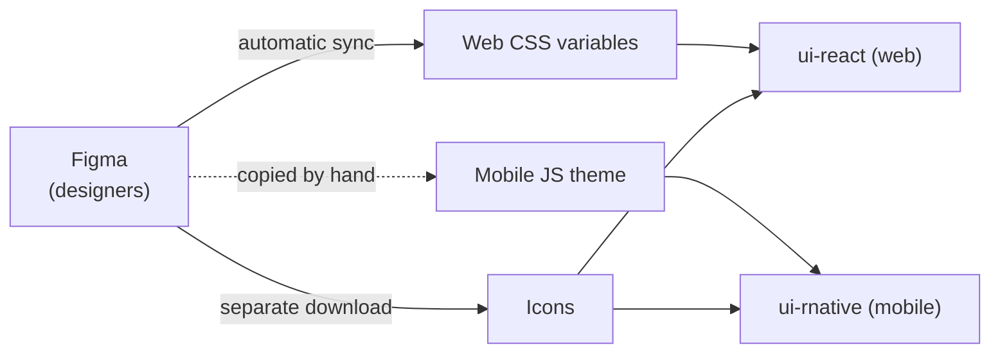
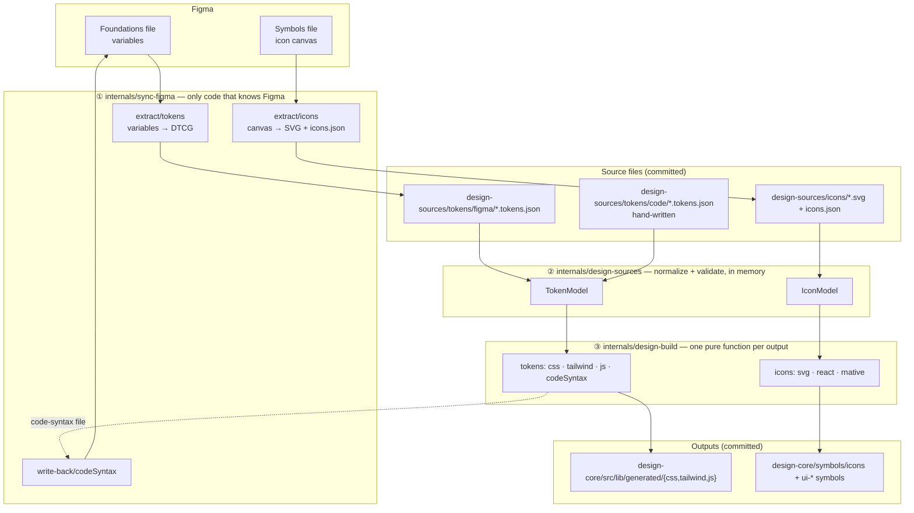
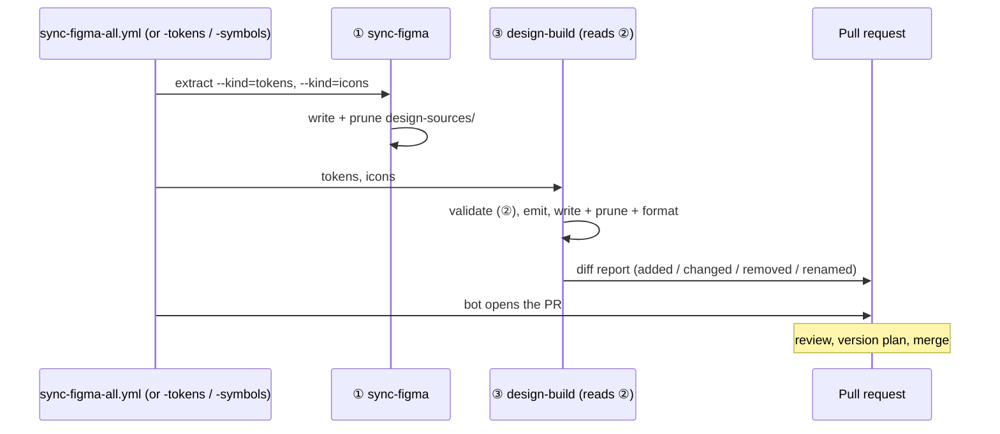
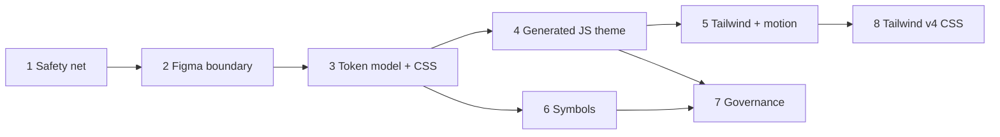
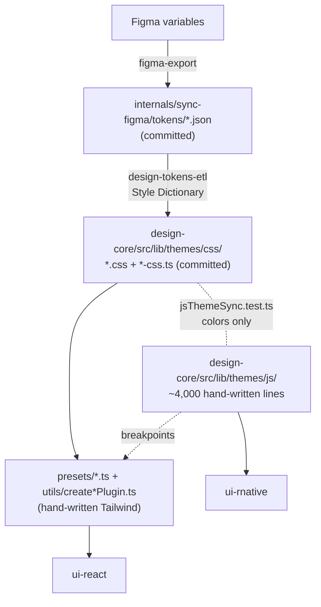

# ADR 0003 — Design pipeline: tokens & symbols from Figma to every platform

- **Status:** Proposed — implemented in the same PR, one commit series per ticket after this ADR
- **Date:** 2026-11-06
- **Epic:** [DLS-1177](https://ledgerhq.atlassian.net/browse/DLS-1177), with
  DLS-393 as the discovery ticket. Tickets are listed in [Plan](#plan).
- **Reference:** the DLS-393 discovery benchmark (Coinbase CDS, Primer,
  Spectrum, MetaMask), and the [DTCG format](https://www.designtokens.org/tr/drafts/format/).

---

## Summary

Designers define Lumen's colors, spacing, typography and icons in Figma. Today
only part of that reaches the code automatically, and only for the web: the
mobile theme is copied by hand, so the two platforms slowly drift apart.

This ADR proposes one pipeline that reads everything from Figma, checks it,
stores it in a standard format, and generates every output from that single
source: web CSS, Tailwind, the React Native theme, icons, and later any other
platform. The work is split into 8 tickets that change nothing for consumers
until a release says so.

## Glossary

| Term                   | Meaning                                                                                                                                                                 |
| ---------------------- | ----------------------------------------------------------------------------------------------------------------------------------------------------------------------- |
| **Design token**       | A named design value, such as `background-surface = #ffffff` or `spacing-16 = 16px`. Components use the name, never the raw value.                                      |
| **Symbol**             | An icon drawn in Figma and shipped as SVG and as React / React Native components.                                                                                       |
| **Mode**               | A variant of the same token set: a **brand** (`enterprise`, `websites`, `ledger-live`), a **theme** (light, dark) or a **breakpoint** (screen size).                    |
| **Figma variables**    | Where designers store tokens in Figma. Our sync reads them through the Figma API.                                                                                       |
| **DTCG**               | The W3C community standard JSON format for design tokens, readable by many tools.                                                                                       |
| **Style Dictionary**   | The open-source tool that turns today's token files into CSS. Our script around it is called the "ETL".                                                                 |
| **Tailwind theme**     | The CSS files that turn tokens into Tailwind classes such as `bg-surface`, used by `ui-react`. Today a JS preset loaded with `@config`; Tailwind v4 CSS after ticket 8. |
| **JS theme**           | The JavaScript object `ui-rnative` reads its values from (`t.colors.bg.surface`).                                                                                       |
| **Output** (or target) | One generated format, such as CSS, the Tailwind theme or the JS theme.                                                                                                  |

---

## Context

Lumen ships two UI libraries from one design: `ui-react` for the web and
`ui-rnative` for React Native. Both must look the same, so both must read the
same design values.

Today the values travel like this:



The web side is generated; the mobile side is typed by a developer after each
Figma change. Icons use a third, unrelated tool.

### Problem

- **Web and mobile drift apart.** Each Figma change must be copied by hand into
  about 4,000 lines of mobile theme, and only colors are checked. They already
  disagree: the largest shadow is 25% opaque on web and 20% on mobile, and four
  components animate at different speeds.
- **Designers' changes get lost.** The build only knows a fixed list of brands
  and screen sizes, and only some value types. A new screen size (`2xl`) and all
  animation values exist in Figma but never reach the code, and nothing warns
  anyone.
- **Some values only exist in code.** Shadows, gradients, animation timings and
  screen sizes are typed twice by hand, once per platform.
- **The tooling is costly to maintain.** The build script is hard to follow,
  every output is written twice, and icons need a repo-wide lint pass to give a
  readable diff.
- **The format is custom.** The token files are only partly standard, so no
  other tool or team can use them without our code.

The result: every Figma sync needs manual follow-up, mistakes reach consumers
silently, and adding a platform means another hand-written copy.

The detailed analysis of today's pipeline is in the
[appendix](#appendix-todays-pipeline-in-detail).

---

## Desired outcomes (decision drivers)

What any solution must deliver, in priority order. The
[alternatives](#alternatives-considered) are judged against them.

| #   | Outcome                                | What it means                                                                                                            | How we'll know                                                                                           |
| --- | -------------------------------------- | ------------------------------------------------------------------------------------------------------------------------ | -------------------------------------------------------------------------------------------------------- |
| 1   | **Fewer drift bugs between platforms** | Web and mobile read values generated from the same source. No design value is typed twice.                               | No hand-written design value left in the libraries; CI fails when web and mobile values differ.          |
| 2   | **Lower maintenance cost**             | A Figma sync needs no hand work. The pipeline is small enough for anyone on the team to read, change and test.           | Sync PRs merge without follow-up commits; the ~4,000 hand-written lines and the old ETL script are gone. |
| 3   | **Designers' intent reaches the code** | Whatever Figma holds (a new brand, theme, screen size or value type) is built without a code change.                     | `2xl` and animation values are built; an unsupported value fails the sync instead of being skipped.      |
| 4   | **A standard format**                  | The source of truth follows DTCG, the industry format, instead of a format of our own.                                   | The source files pass a DTCG validator.                                                                  |
| 5   | **Any output from one source**         | CSS, Tailwind and React Native today; Android, iOS, slide themes or docs later, each as one more generated output.       | Adding an output needs no change to how sources are read or checked.                                     |
| 6   | **One pipeline for every asset type**  | Tokens and icons use the same steps and tools; illustrations or animations can join later.                               | Icons run on the same three steps as tokens.                                                             |
| 7   | **Safe, reviewable changes**           | Consumers see nothing until a versioned release. Every sync PR shows what changed, and removals or renames are explicit. | Snapshot tests guard each migration step; the sync PR lists added, changed, removed and renamed tokens.  |

### Constraints

- Package entry points stay `.`, `./cn` and `./symbols/*`, so consumers change
  nothing. The `dist/` restructure (DLS-919) is a separate change.
- `ui-rnative` keeps reading the theme in its current shape. The Tailwind
  preset keeps its classes until ticket 8 replaces it with CSS that generates
  the same ones.
- Pipeline code is dev-only and follows the `## Internals` rules in
  `AGENTS.md`: never published, never imported by `libs/*`.

---

## Decision

### In plain words

We replace today's three separate flows with **one pipeline in three steps**,
each owned by one small internal project:

1. **Fetch** — `sync-figma` is the only code that talks to Figma. It saves
   tokens and icons as files in the standard format.
2. **Check** — `design-sources` holds those files (plus the few values that
   only exist in code), checks them, and combines brands, themes and screen
   sizes into one complete model.
3. **Build** — `design-build` turns that model into every output: CSS,
   Tailwind, the React Native theme, icons. Each output is one small function,
   so a new platform is one more function.

Generated files stay committed in the repo, so every change is visible in
review, and CI fails if anyone edits them by hand or if they fall out of date.

### How the decision delivers each outcome

| Outcome                   | Delivered by                                                                                                                                      |
| ------------------------- | ------------------------------------------------------------------------------------------------------------------------------------------------- |
| 1. Fewer drift bugs       | One model; CSS, Tailwind and JS are all generated from it (tickets 3–5), plus a test that compares web and mobile values                          |
| 2. Lower maintenance cost | The sync runs Fetch then Build with no hand step; the generated JS theme replaces the hand-written one (ticket 4); the ETL script goes (ticket 3) |
| 3. Designers' intent      | Brands, modes and value types are read from the files; anything unknown fails the check (tickets 2–3)                                             |
| 4. A standard format      | `design-sources` holds valid DTCG (ticket 2)                                                                                                      |
| 5. Any output             | Every output implements the same small `Target` contract; Android, iOS or slides are one more target                                              |
| 6. One pipeline           | The three steps carry shared tools (Figma client, write + prune, check, diff report); icons join in ticket 6                                      |
| 7. Safe, reviewable       | Snapshots first (ticket 1), byte-identical refactors, diff report and rename/removal gate in the sync PR (ticket 7)                               |

### Design details

The rest of this section is for the engineers doing the work.

#### Three internal projects, by stage, with folders by asset kind



| Stage | Project                    | Job                                                                                                                  | May import                  | Writes to                                          | Nx targets                                    |
| ----- | -------------------------- | -------------------------------------------------------------------------------------------------------------------- | --------------------------- | -------------------------------------------------- | --------------------------------------------- |
| ①     | `internals/sync-figma`     | Figma REST client; extract tokens and icons; upload code syntax                                                      | `design-sources` types only | `design-sources/` source files; Figma (write-back) | `extract --kind=tokens\|icons`, `code-syntax` |
| ②     | `internals/design-sources` | Hold the source files; load → merge → validate → resolve aliases → expand brand × theme × breakpoint; validate icons | nothing internal            | nothing                                            | `validate`, `test`                            |
| ③     | `internals/design-build`   | Turn the model into every output file; write + prune + format; `--check` against git; diff report                    | `design-sources`            | generated folders in `libs/*`                      | `tokens`, `icons`, `check`, `test`            |

Nothing imports ①. The import rules are enforced by Nx tags and
`depConstraints`, like the existing `scope:internal` rule.

#### Principles

1. **One direction.** Figma → source files → model → outputs. Only ① talks to
   Figma, ② never writes to disk, ③ never reads raw Figma data.
2. **Projects by stage, folders by asset kind.** The infrastructure (Figma
   client, write + prune, `--check`, diff report) is per stage and shared by
   every kind. Adding Lottie later is one folder per project and one workflow
   job.
3. **Files exist at two points only.** Source files and outputs are committed
   and reviewed. The model lives in memory, so no intermediate artifact can go
   stale.
4. **Every output is a pure function of the model.** Outputs are tested without
   a file system or network; `--check` is "run every output and compare with
   git", so a committed file can't fall behind its generator. It does not prove
   two targets agree, so a parity test keeps comparing the values the CSS and
   JS targets emit for each token.
5. **Parity before change.** Each refactor ticket keeps outputs byte-identical,
   guarded by the snapshots from ticket 1. A visible change always lands in its
   own PR with a version plan.
6. **Code syntax is an output.** ③ emits the names Figma Dev Mode shows (Tailwind
   class, `t.*` path), using the same naming function as the outputs; ① uploads
   the file. Figma and code can't disagree on a name.

#### The output contract

```ts
// internals/design-build/src/core/target.ts
export type OutputFile = { path: string; contents: string };

export type Target<Model> = {
  name: string; // 'css', 'react-symbols', 'android'…
  outDir: string; // from one config file
  emit(model: Model): OutputFile[] | Promise<OutputFile[]>; // pure: no fs, no Figma
  owns?: (relativePath: string) => boolean; // when hand-written files share outDir
  format?: boolean; // prettier on by default
};
```

The writer formats with prettier, writes, and prunes files a target no longer
emits. `--check` runs the same targets and fails on any difference with the
working tree. `emit` may be async only because svgr is; `owns` keeps the
hand-written `lumen.css` out of the Tailwind target's prune.

#### Where each kind of value lives

| Kind                                                                              | Examples                                                                                       | Lives in                                                                            |
| --------------------------------------------------------------------------------- | ---------------------------------------------------------------------------------------------- | ----------------------------------------------------------------------------------- |
| Values designers own in Figma                                                     | colors, spacing, sizes, radius, typography, icon and spot sizes, durations, easings            | `design-sources/tokens/figma/` (written by ①)                                       |
| Values designers own that Figma variables can't hold, or that both platforms need | shadows, extra sizes, border widths, the durations Figma lacks, delays, breakpoint min-widths  | `design-sources/tokens/code/` as DTCG `shadow`, `dimension`, `duration`             |
| Mappings from Tailwind class names to variables                                   | `.heading-0 { font-size: var(--font-style-heading-0-size) … }`, theme color keys, spacing keys | generated by ③ into `design-core/tailwind/theme.css` and the per-brand entries      |
| CSS behavior with no design value and no React Native equivalent                  | dark variant, keyframe shapes, web `zIndex` layers, scrollbar, mask and gradient geometry      | hand-written in `design-core/tailwind/lumen.css`, imported by every generated entry |

The rule: a value goes to `design-sources` if designers own it or more than one
platform needs it. Code that only wires tokens into Tailwind stays in
`lumen.css`. If designers later move shadows into Figma, only their source file
changes.

#### DTCG type mapping (ticket 2)

| Figma                                                | DTCG `$type`                                                     |
| ---------------------------------------------------- | ---------------------------------------------------------------- |
| `FLOAT` in a size, gap, radius, stroke or text scope | `dimension` with `px` (removes `addPxUnitToNumber`)              |
| `FLOAT` in an opacity / font-weight scope            | `number` / `fontWeight`                                          |
| `FLOAT` with no telling scope (primitives)           | by group name: `duration`, `number` or `dimension`, else fails   |
| `STRING` font weight / family                        | `fontWeight` / `fontFamily`                                      |
| `TIMING`                                             | `duration`                                                       |
| `EASING`                                             | `cubicBezier`                                                    |
| `COLOR`                                              | `color` as a DTCG 2025.10 object (`srgb` components, alpha, hex) |
| `BOOLEAN`                                            | dropped: nothing reads them                                      |

Scopes come from the Figma variable's `scopes` field. Primitives are hidden
from Figma's pickers, so their scopes are empty or `ALL_SCOPES` and their
group name decides; a FLOAT that neither describes fails the export, and the
rule keeps every committed token's type. Figma returns `TIMING` in seconds and
`EASING` as float32 Bézier points: the export writes milliseconds and rounds
the points. A spring easing fails, since it still carries a stale Bézier
curve and DTCG has no spring type. Variables deleted in Figma but still
referenced are skipped, so the dangling reference fails validation. File
names are lowercased and hyphenated (`Ledger Live` → `ledger-live`), and a
test checks design-sources can read every one. `design-sources:validate` parses every file with
Terrazzo's DTCG parser and fails on any warning, since the parser only warns
on, for example, a hex string color.

#### Folder structure

```text
internals/
├─ sync-figma/                 ① exists, slimmed down
│  └─ src/
│     ├─ client/               REST: auth, retry, rate limit, types
│     ├─ extract/
│     │  ├─ tokens.ts          variables → DTCG
│     │  └─ icons.ts           canvas → SVG + manifest
│     ├─ write-back/
│     │  └─ codeSyntax.ts      uploads ③'s code-syntax file
│     ├─ shared/
│     │  └─ writeSourceFiles.ts   write + prune
│     └─ testing/              recorded responses
├─ design-sources/             ② new
│  ├─ tokens/
│  │  ├─ figma/*.tokens.json   written by ①, never edited
│  │  └─ code/*.tokens.json    hand-written
│  ├─ icons/
│  │  ├─ *.svg                 written by ①, never edited
│  │  └─ icons.json
│  └─ src/
│     ├─ tokens/               load, validate, standard (Terrazzo), model
│     └─ icons/                naming, validate
└─ design-build/               ③ new
   ├─ generated/
   │  └─ code-syntax.json      uploaded to Figma by ①
   └─ src/
      ├─ config.ts             every target and its outDir
      ├─ core/
      │  ├─ target.ts          the output contract
      │  ├─ writer.ts          write + prune + prettier
      │  ├─ check.ts           --check against git
      │  └─ diffReport.ts
      ├─ tokens/
      │  ├─ css.ts  js.ts  tailwindV4.ts  codeSyntax.ts
      │  ├─ layers.ts             brand × theme and breakpoint layers
      │  ├─ naming.ts  cssLayers.ts  selections.ts   shared helpers
      │  └─ tailwindBlocks.ts  typography, shadow and motion pieces
      └─ icons/
         └─ svg.ts  components.ts   react and rnative via svgr + svgo

libs/design-core/
├─ src/lib/
│  ├─ generated/               written by ③, never edited
│  │  ├─ css/                  today's themes/css
│  │  └─ js/                   today's themes/js (ticket 4)
│  └─ tailwind/                the Tailwind snapshot test
├─ tailwind/                   published as ./tailwind/* (ticket 8)
│  ├─ theme.css                written by ③
│  ├─ <brand>.css              written by ③, one per brand + all-brands.css
│  └─ lumen.css                hand-written wiring
└─ symbols/icons/              published as ./symbols/*, path unchanged
```

Package exports stay `.`, `./cn` and `./symbols/*`, so moving folders under
`src/` is invisible to consumers; ticket 8 adds `./tailwind/*`. The `dist/`
restructure (DLS-919) is a separate change.

#### How a sync runs



On every PR, `design-build:check` fails on invalid sources or on any output
that differs from what is committed.

---

## Plan

**Epic:** `[LUMEN] Design pipeline: tokens & symbols`. DLS-393 is its discovery
ticket. All tickets are tech tasks (no platform prefix), labeled `tech_DLS`.



### 1. Safety net for generated outputs — can start now

Freeze today's outputs so every later ticket can prove it changed nothing, and
give generated code its own folder.

- Snapshot tests: the resolved Tailwind preset (theme and generated utilities)
  per brand, the JS theme per brand and mode, and the generated symbols — path
  and content hash of every published SVG and of the React and React Native
  components and barrels, so a changed path, fill, prop or export fails even
  when no file is renamed.
- Extend `jsThemeSync.test.ts` to spacing, sizes, radius, border width,
  typography, shadows and motion. Fix each drift it finds or file a ticket
  (`shadow-2xl` is known).
- Duplicate `.css` files: confirm only tests read them, point the tests at the
  `-css.ts` maps, then remove them.
- Move-only commit: `themes/css` → `generated/css`, `themes/js` →
  `generated/js`, `presets/` and `utils/create*Plugin.ts` → `tailwind/`. Update
  the paths in `internals/sync-figma/src/config.ts`.

**Done when:** snapshots are committed and CI is green; the built `dist/` is
unchanged; version plan for `@ledgerhq/lumen-design-core`.

### 2. Figma boundary in sync-figma

Make `sync-figma` the only code that talks to Figma, and have it export every
variable as valid DTCG.

- One REST client in `src/client/` (auth, retry on rate limit, typed
  responses), used by tokens, icons and code syntax.
- Record a real `getLocalVariables` response as a fixture first; all tests run
  on recorded responses, with no network.
- The token extractor handles every variable type and applies the
  [DTCG type mapping](#dtcg-type-mapping-ticket-2), including `TIMING` →
  `duration` and `EASING` → `cubicBezier`. Decide the color format.
- Generalize `pruneStaleTokenFiles` (from #956) into `writeSourceFiles`
  (write + prune) for every kind.
- Output location unchanged; ticket 3 moves the files.
- The Style Dictionary ETL still reads these files until ticket 3 replaces it,
  and today it only adds units to bare numbers. Add a small adapter in the ETL
  that turns the new types back into today's CSS values (`dimension` objects to
  `16px`, and so on); ticket 3 deletes it with the ETL.
- Split the GitHub workflow into three, so tokens and symbols can be synced
  separately:
  - `sync-figma-tokens.yml`: export tokens, build, open a tokens PR.
  - `sync-figma-symbols.yml`: download symbols, generate the React and React
    Native components, open a symbols PR.
  - `sync-figma-all.yml` (today's `sync-figma.yml`, renamed): runs both and
    opens one combined PR.

  The tokens and symbols workflows are reusable (`workflow_call` +
  `workflow_dispatch`), so `all` calls them instead of duplicating steps. Each
  takes only the inputs it needs and uses its own bot branch and concurrency
  group. Update the `AGENTS.md` Internals example (`sync-figma` ↔
  `sync-figma.yml`): the project now serves several workflows, so it's named
  after its role.

**Done when:** the export reproduces today's token files with corrected types,
plus the motion collection; running the ETL on them leaves `generated/css`
byte-identical (empty `git diff`); `7.motion.Mode1.json` is pruned; the three
workflows each run from the Actions tab and open the expected PR, and
`sync-figma.yml` is gone; the README and `AGENTS.md` describe them. No version
plan (internals only).

**Depends on:** 1.

### 3. Token model and CSS output

Create `design-sources` and `design-build`, and replace the Style Dictionary
ETL script with a CSS output that produces the same files.

- `design-sources`: move the token files to `tokens/figma/`, create
  `tokens/code/`. Load, merge, validate (types, references, cycles, naming, the
  same keys in every mode), resolve aliases, expand brand × theme ×
  breakpoint. Errors name the file and the token path.
- Brands and breakpoints come from the files. This builds `2xl`: a visible
  change, shipped in its own PR.
- `design-build` core: the `Target` contract, the writer (write + prune +
  prettier), `--check`, the diff report.
- CSS output as plain functions over the model, sharing two helpers (the
  declarations per layer, and the mode selections), then delete
  `designTokensEtl.ts` and the `style-dictionary` dependency.
- Nx tags and `depConstraints`, `## Internals` rows in `AGENTS.md`,
  `npx nx sync`.

**Done when:** `generated/css` is byte-identical to the ticket 1 snapshot;
`check:agent-docs` passes with the two new projects; validation rules match the
designers' answers on naming and modes.

**Depends on:** 2.

### 4. Generated JS theme

Generate the React Native theme from the model and delete the hand-written
copy.

- Move the values that only exist in code into `tokens/code/`: shadows (DTCG
  `shadow`), gradients (`gradient`) and breakpoint min-widths (`dimension`),
  referencing color tokens. Motion comes from the Figma export (ticket 2);
  reconcile it with `primitives.motion.ts`.
- JS output into `generated/js`, in the exact shape `ui-rnative` reads today
  (for example `ledgerLiveThemes.dark.colors.bg.*`), including the exported
  types.
- `createScreensPlugin` reads the generated breakpoints instead of the
  hand-written JS primitives.
- Delete the hand-written files (about 4,000 lines). Replace
  `jsThemeSync.test.ts` with a parity test in `design-build` that, for every
  token in every brand × theme, compares the value the CSS target emits
  (resolved through its `var()` chain) with the value the JS target emits.
  `--check` alone wouldn't catch two emitters that disagree.
- Retire the `figma-token-sync` skill and its `AGENTS.md` row.

**Done when:** the JS theme snapshot is unchanged (apart from drifts fixed in
ticket 1); the CSS/JS parity test passes for every brand and theme;
`ui-rnative` typecheck and tests pass; version plan for
`@ledgerhq/lumen-design-core`.

**Depends on:** 3.

### 5. Generated Tailwind theme and motion tokens — needs a design decision

Feed the Tailwind preset from generated maps, and move hard-coded values onto
tokens.

- Tailwind output into `generated/tailwind`: theme maps, typography classes,
  shadow and gradient utilities from the model. The presets and plugins read
  them instead of hand-written maps and literals.
- `createAnimationsPlugin` and components use the motion tokens on both
  platforms.
- Design prerequisite: settle the web/RN mismatches — AmountDisplay 600 vs
  700 ms, Toast 300 vs 200, BaseInput label 300 vs 150, SegmentedControl 200/250
  vs 300.

**Done when:** the Tailwind snapshot is unchanged by the switch to generated
maps (a separate commit from the motion change); no hard-coded durations,
shadows or gradients remain in components or plugins; version plans for the
libs touched.

**Depends on:** 4.

### 6. Symbols on the shared pipeline

Move the icon flow onto the three stages, with the same output as today.

- ① `extract/icons`: SVGs plus `icons.json` (Figma node ids, last modified)
  into `design-sources/icons/`, with write + prune instead of clearing the
  folder.
- ② icon model: naming and validation (`viewBox`, `currentColor`, no stray
  fills).
- ③ outputs: `svg` (published path unchanged), `react`, `rnative`, reusing the
  existing svgr templates (svgo runs there), formatted by the writer.
- Delete `figmaDownloadSvgs.ts`, `generate-symbols.mts` and the workflow's
  `lint --fix` step.

**Done when:** generated symbols are identical to the ticket 1 snapshot; adding
a fake asset kind needs no change to `core/`.

**Depends on:** 3. Can run in parallel with 4 and 5.

### 7. Governance and docs

Make drift impossible to merge, and token or symbol changes easy to review.

- `design-sources:validate` and `design-build:check` on every PR.
- Diff report in the sync PR body: added, changed, removed, renamed, per
  mode.
- Removals and renames fail unless explicitly approved: a separate gate
  workflow re-runs on the `design-sources: approve removals` label, so adding
  the label is enough. It compares the source tokens and icons, and the public
  names the outputs define (CSS variables, Tailwind utilities, React Native
  `t.*` paths), so a rename made in design-build is caught too. It runs on
  every PR and exits early when the pipeline isn't touched, so it can be a
  required check.
- A multi-mode collection no output builds fails the build, unless it is
  listed with the reason (`icon` and `spot` are Figma component size modes
  whose values point at built primitives).
- The sync workflows hand the changes to the PR step as a git patch, and open
  the PR with a token from the Lumen release GitHub App, which the release
  workflow already uses: PRs opened with `GITHUB_TOKEN` don't trigger CI.
- `code-syntax` output from ③ for web, iOS and Android (the CSS variable, and
  the `t.*` theme path), uploaded to Figma by ①.
- READMEs for the three projects; update the `figma-to-code` and
  `component-styling` skills where they describe the old flow.

**Done when:** a hand edit in a generated folder fails CI; Dev Mode names match
the code for every token.

**Depends on:** 4 and 6.

### 8. Tailwind v4 CSS output

Lumen is on Tailwind v4 but ships its theme as a JS preset loaded with
`@config`. Generate a pure CSS file instead, so consumers `@import` it.

- New target writing a Tailwind v4 CSS file: `@theme` variables in Tailwind's
  namespaces (`--color-*`, `--spacing-*`, `--radius-*`, `--shadow-*`,
  `--text-*`, `--ease-*`, `--breakpoint-*`), `@theme inline` mapping them to the
  runtime variables, `:root` / `.dark` / per-brand value blocks, `@utility` for
  the custom classes (typography, icon and spot sizes, gradients) and
  `@custom-variant dark`.
- One file per brand, or one file with a brand selector (to decide).
- One shared generated `theme.css`, a small entry per brand and
  `all-brands.css` (brand classes on a parent), plus a hand-written
  `lumen.css` for the utilities and variants that are not tokens.
- Generated first alongside the preset and checked against it, then the preset
  and its plugins are removed in the same epic (decided on 2026-11-09):
  `ui-react` moves to the CSS, and the consumer migration (`@config` →
  `@import`) ships as a flagged breaking change in a patch release.

**Done when:** a test page compiled with the CSS file produces exactly the same
classes and values as the current preset for every brand (checked against the
ticket 1 snapshot); dark mode and brand switching work without JS config; the
consumer migration steps are written down; version plan for
`@ledgerhq/lumen-design-core`.

**Depends on:** 5.

---

## Acceptance criteria (epic)

- One command rebuilds every token and symbol output from committed sources,
  with no network.
- `ui-react` and `ui-rnative` read the same generated values; there is no
  hand-written copy of a design value in `themes/js` or in the Tailwind plugins.
- Every brand, theme and breakpoint present in Figma is built without code
  changes.
- CI fails on invalid sources, stale outputs, hand edits to generated files and
  unapproved removals or renames.
- Consumers see no change until a PR with a version plan says so.

## Consequences

- **Positive:** web and mobile can't drift; a Figma sync PR needs no manual
  follow-up; adding an asset kind or a platform is one folder or one target.
- **Negative:** two more Nx projects to maintain, and our own token engine
  instead of a library. The engine is small (load, validate, resolve, expand
  modes), DTCG conformance is checked by Terrazzo's parser, and the outputs are
  plain functions.
- **Breaking for web consumers:** the JS presets go (ticket 8). The CSS
  generates the same classes, so the migration is an import swap, written in
  the `design-core` README and the `lumen-consumer-upgrade` skill.
  `tailwindcss` becomes an optional peer of `design-core`, so React Native
  apps don't install it.
- **Generated files stay committed**, so a sync PR is larger, but every token
  change is readable in review and the repo works right after a clone.

## Alternatives considered

| Option                                                    | Why not                                                                                                                                                                                                                                                                                      |
| --------------------------------------------------------- | -------------------------------------------------------------------------------------------------------------------------------------------------------------------------------------------------------------------------------------------------------------------------------------------- |
| Style Dictionary v4 with custom formats                   | Maintenance cost: a spike showed it reproduces every output byte for byte, but only through a custom format per output; ② owns modes, which it lacks. The library added a config layer and a dependency without formatting anything itself, so the outputs are plain functions.              |
| Keep today's ETL and add a JS format                      | Designers' intent, maintenance cost: its globally registered transform chain is hard to follow, and its fixed brand and breakpoint lists drop new modes silently.                                                                                                                            |
| Terrazzo for the outputs                                  | Constraints, fewer drift bugs: its Tailwind plugin does not produce our custom utilities (typography, gradients, brand classes) and its JS output doesn't match the `ui-rnative` shape. Its parser does sit inside ② as the DTCG check. Either tool can back a future Android or iOS target. |
| Two projects (boundary by folder only)                    | Maintenance cost: the step rules would be conventions, not lint errors.                                                                                                                                                                                                                      |
| Four projects (separate Figma client)                     | Maintenance cost: the client has a single caller.                                                                                                                                                                                                                                            |
| Generate outputs at build time instead of committing them | Reviewable changes, maintenance cost: token changes become invisible in review, and every build depends on the pipeline.                                                                                                                                                                     |
| Publish the DTCG files                                    | Not needed yet (outcome 4 only needs DTCG sources): no consumer has asked; every rename would become a breaking change. Adding it later is one more target.                                                                                                                                  |

## Out of scope

- **Lottie:** a folder slot only. Figma doesn't store Lottie and the repo has
  none; designed once the source is known.
- **Android and iOS outputs:** wait for a real consumer. Ledger Live mobile is
  React Native and gets the JS theme.

## Open questions

- **Designers:** naming and mode rules that ticket 3 validates (asked on the
  DLS-393 decisions page). Until then naming issues are warnings: `Zcash-0%`,
  `Pressed`, `gradient overlay`, `size 2` in the token files, and the
  ` nested`, `ai bubble` and `auto-Lock` icons; the two chevron icons hard-code
  `#D5D5D5`.
- **Design (values kept as they are until decided):** `blur.lg` (Figma 16, the
  React Native TabBar 64) and the `shadow-2xl` color (25% web, 20% mobile),
  both listed in `design-build/src/tokens/pendingDecisions.ts`; the four motion
  mismatches; the web `ease-in` / `ease-out` keywords, which are not the Lumen
  easing tokens.
- **Design (next Figma sync):** the live file has moved on since the recorded
  fixture. The motion collection is renamed `7.motion` → `7.animation`, and
  its durations are now 75, 100, 150, 200, 300, 500, 700 and 1000 ms: 0, 250
  and 2000 are gone. The code duration tokens and the 250 ms
  `translate-from-right` animation need a decision before that sync merges;
  the removal gate holds it until then.
- **Engineering:** `boolean` variables are dropped, as nothing reads them.
  Figma `EASING` variables can also hold spring values, which DTCG has no
  type for; the export fails on them until one is needed.

---

## Appendix: today's pipeline in detail

### Tokens today



- **The ETL** (`src/automations/designTokensEtl.ts`, 347 lines) runs Style
  Dictionary 22 times: once for primitives, once per brand × theme (6), and once
  per breakpoint inside the brand loop (15, so the same 5 typography files are
  written 3 times). Transforms, filters, formats and actions are registered
  globally, and the actions are registered after the first builds start.
- **Hard-coded lists.** Brands (`enterprise`, `websites`, `ledger-live`),
  themes and breakpoints (`xs`…`xl`) are constants. The ETL reads only files
  `1.`–`4.`, so `4.breakpoint.2xl.json`, `5.icon.*`, `6.spot.*` and
  `7.motion.Mode1.json` are exported and never built. A new brand or mode in
  Figma is silently ignored.
- **Each output is written twice.** Every `-css.ts` map has a `.css` twin. Only
  the `-css.ts` maps are imported (by the presets, `createPrimitivesPlugin` and
  tests).
- **React Native gets nothing generated.** `themes/js/**` (4,018 lines across
  brands, primitives and typographies) is typed by hand after every Figma sync.
  `jsThemeSync.test.ts` compares only the `bg`, `text`, `border`, `crypto` and
  `discover` color groups; spacing, sizes, radius, typography, shadows and
  motion can drift unnoticed.
- **Motion is not exported.** `tokenFilesFromLocalVariables.ts` supports
  `BOOLEAN`, `COLOR`, `FLOAT` and `STRING`; Figma's motion collection uses
  `TIMING` and `EASING` and is skipped. `7.motion.Mode1.json` is a stale file
  that the prune added in #956 will delete on the next export.

### Values written directly in Tailwind

Some design values never pass through the token files. They are typed into the
Tailwind plugins, and typed again for React Native:

| Value                                                                | Tailwind (web)                                                           | React Native copy                                           | Drift known                         |
| -------------------------------------------------------------------- | ------------------------------------------------------------------------ | ----------------------------------------------------------- | ----------------------------------- |
| Shadows (offsets, blur, `rgba(0,0,0,0.10)` / `0.25`)                 | `createShadowPlugin` in `utils/createCustomPlugin.ts`                    | `themes/js/primitives/primitives.shadows.ts`                | `shadow-2xl`: 25% web vs 20% mobile |
| Gradients (angles, stops, radial geometry)                           | `createGradientPlugin` in `utils/createCustomPlugin.ts`                  | `themes/js/primitives/primitive.gradients.ts`               | not checked                         |
| Durations and easings (`300ms ease-in`, `cubic-bezier(0.4,0,0.2,1)`) | `utils/createAnimationsPlugin.ts`, and components                        | `themes/js/primitives/primitives.motion.ts`, and components | 4 components (see ticket 5)         |
| Breakpoints                                                          | `createScreensPlugin` reads them **from the hand-written JS primitives** | `themes/js/primitives/primitives.others.ts`                 | —                                   |

### Symbols today

- `figmaDownloadSvgs.ts` downloads the icon canvas into
  `libs/design-core/symbols/icons/` (clearing it first), then
  `generate-symbols.mts` runs svgr into `ui-react` and `ui-rnative`.
- It shares nothing with the token flow: no shared Figma client, prune, check
  or diff report.
- svgr output is unformatted, so the workflow runs a repo-wide
  `lint --fix`, or about 590 files show formatting noise.
- Nothing validates names, `viewBox` or hard-coded fills.

### DTCG status of the token files

The exported files are **partly** DTCG:

| Compliant                                    | Not compliant                                                                                                                               |
| -------------------------------------------- | ------------------------------------------------------------------------------------------------------------------------------------------- |
| `$value`, `$type`, `$description`            | Dimensions are `$type: "number"` with no unit (about 700 entries); the ETL adds `px` (`addPxUnitToNumber`)                                  |
| `{a.b.c}` aliases                            | Font weights and families are `$type: "string"`                                                                                             |
| Figma metadata under `$extensions.com.figma` | `boolean` is not a DTCG type (2 tokens)                                                                                                     |
| One file per mode                            | No `duration`, `cubicBezier`, `shadow`, `gradient` or `typography` composites (typography is flattened, shadows and gradients live in code) |

Colors are hex strings. Whether to move to the DTCG 2025.10 color object
(`{ colorSpace, components, hex }`) is an open question for ticket 2.
