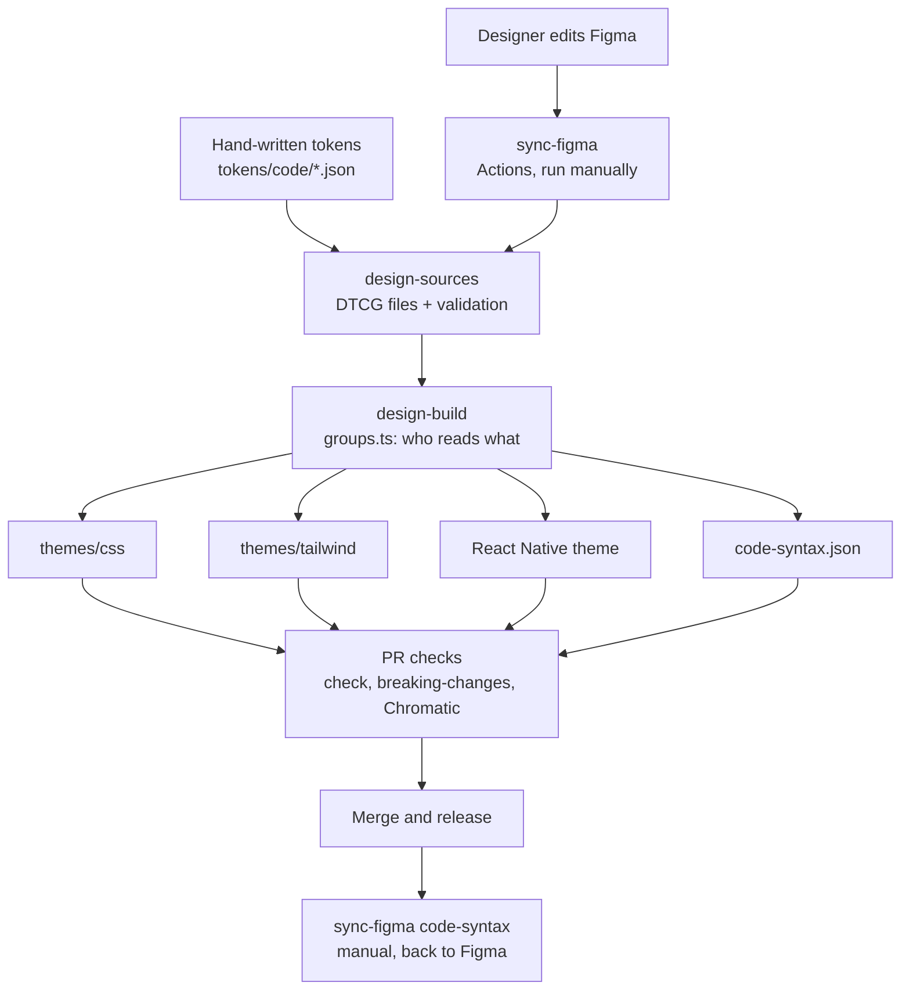

# Design pipeline

How design tokens and icons go from Figma to the published packages. Why it
is built this way: [ADR 0003](adr/0003-design-pipeline.md).



| Stage                                                     | Job                                                   |
| --------------------------------------------------------- | ----------------------------------------------------- |
| [`sync-figma`](../internals/sync-figma/README.md)         | The only code that talks to Figma: export, upload.    |
| [`design-sources`](../internals/design-sources/README.md) | The committed DTCG files, validated, and their model. |
| [`design-build`](../internals/design-build/README.md)     | Every output, built from the model, and its check.    |

## Outputs

| Output                     | Path                                                  | Consumers import                                          |
| -------------------------- | ----------------------------------------------------- | --------------------------------------------------------- |
| Plain CSS variables        | `libs/design-core/themes/css/<brand>.css`             | `@ledgerhq/lumen-design-core/themes/css/<brand>.css`      |
| Tailwind v4 theme          | `libs/design-core/themes/tailwind/<brand>.css`        | `@ledgerhq/lumen-design-core/themes/tailwind/<brand>.css` |
| React Native theme + types | `libs/design-core/src/lib/generated/js/`              | `@ledgerhq/lumen-design-core` (`ledgerLiveThemes`…)       |
| `cssVar` names             | `libs/design-core/src/lib/generated/css/`             | `cssVar('var(--…)')`                                      |
| Icons                      | `libs/design-core/symbols/icons/` + symbol components | `./symbols/*`, `ui-react`, `ui-rnative`                   |
| Dev Mode code syntax       | `internals/design-build/generated/code-syntax.json`   | Figma Dev Mode, after upload                              |

Generated files are never edited by hand: change the source or the target.

## Sync from Figma

1. Designers update the variables or icons in Figma.
2. Run **Sync Figma** from the Actions tab (`sync-figma.yml`), with `kind`:
   `tokens`, `symbols` or `all`.
3. It exports to `design-sources`, builds every output, and opens a PR on
   `sync-figma-<kind>` with the diff report as its description and a version
   plan per changed package. If the build fails, the PR opens as a draft with
   the error: fix it on that branch.
4. Review the PR: the checks below, and Chromatic for visual changes.
5. After merging a tokens sync, [upload the code syntax](#publish-the-names-to-dev-mode).

## Add a hand-written token

For values Figma variables can't hold (shadows) or that only code needs
(durations, breakpoints):

1. Edit `internals/design-sources/tokens/code/<group>.tokens.json` (DTCG).
2. `npx nx run design-build:tokens`.
3. Commit the source and the outputs, with a version plan for
   `@ledgerhq/lumen-design-core`.

A new token in an existing group needs nothing else. A new file is a new
collection: add it to the collections `cssLayers.ts` builds, next to `shadow`.

## Add a token group

1. Add the tokens: in Figma (then sync), or as a code file (above).
2. `npx nx run design-build:tokens` fails with `No group for …`: the build
   never lets a group skip an output silently.
3. Add one row to `GROUPS` in
   `internals/design-build/src/tokens/groups.ts`:

   ```ts
   opacity: { tailwind: ['--opacity'], reactNative: 'opacity' },
   ```

   CSS variables need no row field. `tailwind` names the theme namespaces the
   variables fill; `reactNative` the theme path. `webOnly: 'why'` keeps a
   group off React Native.

4. Rebuild, then `npx nx run design-build:test` and `design-build:check`.

More than the row only when the group is new in kind:

| The group…                                       | Also change                                                     |
| ------------------------------------------------ | --------------------------------------------------------------- |
| has a value type an output doesn't write yet     | `cssValue` (`cssLayers.ts`), `px` (`js.ts`)                     |
| uses a new DTCG `$type`                          | `DTCG_TYPES` and `VALUE_CHECKS` in `design-sources`             |
| combines tokens into one style (like typography) | a builder in `js.ts`, listed in `BUILT_BY_FUNCTION`             |
| is a new multi-mode Figma collection             | `BUILT_MODE_COLLECTIONS` or `UNBUILT_COLLECTIONS` in `modes.ts` |

## Publish the names to Dev Mode

Dev Mode shows each variable's code name per platform: the CSS variable on
web, the `t.*` path on iOS and Android. After a merge that changes token
names:

```bash
FIGMA_API_TOKEN=… FIGMA_FOUNDATIONS_FILE_KEY=… npx nx run sync-figma:code-syntax
```

It writes to the live Figma file (only the variables that differ), so it is
run by hand. The token needs the `file_variables:write` scope.

## What CI checks

- `design-build:check` (`pr.yml`): the sources are valid DTCG, and every
  committed output matches them.
- `check:breaking-changes`: a removed or renamed public name (CSS variable,
  Tailwind utility, React Native path, icon) needs a migration
  ([write-migration](../.claude/skills/write-migration/SKILL.md)).
- Chromatic: the visual change, on web and React Native.
